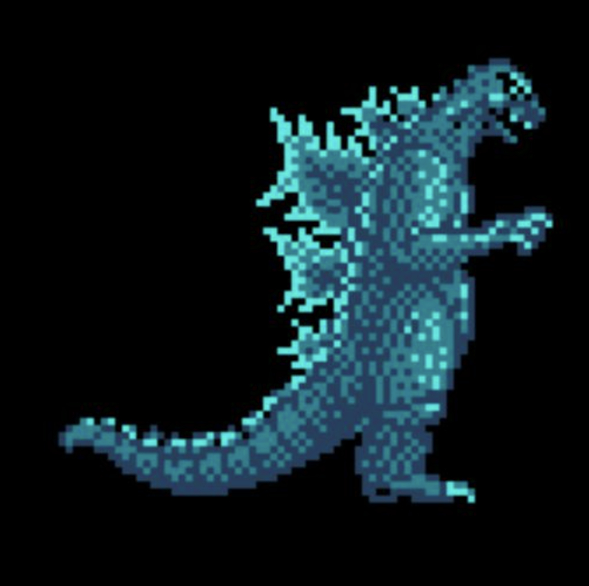
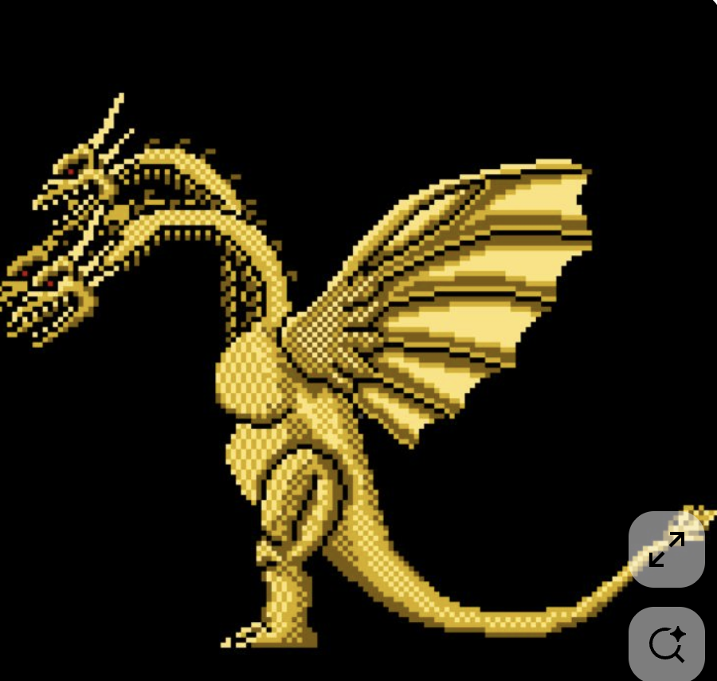
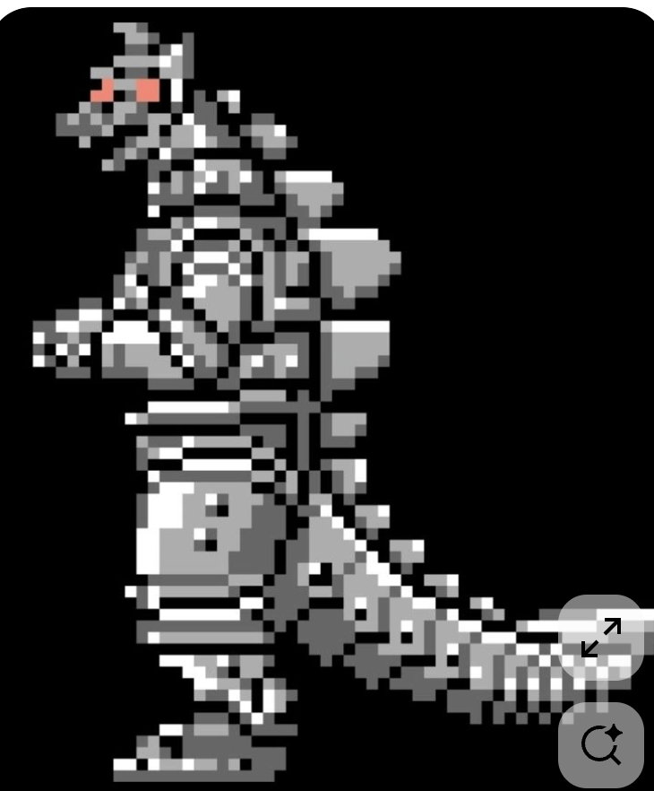
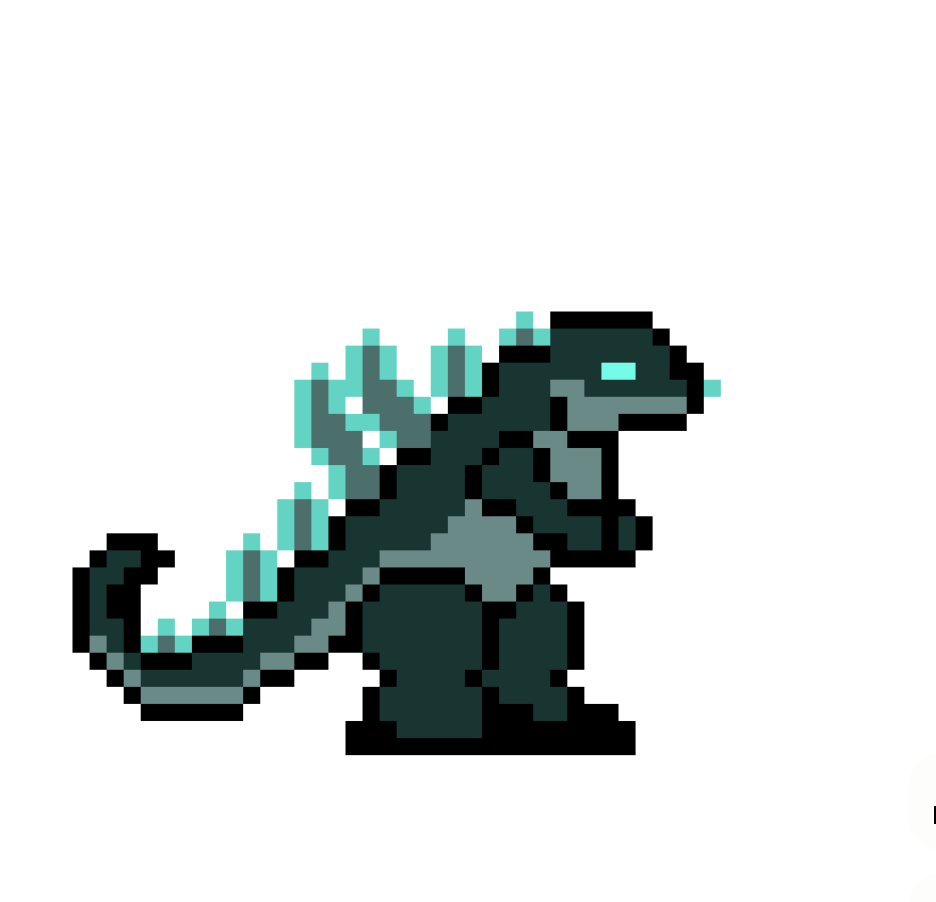
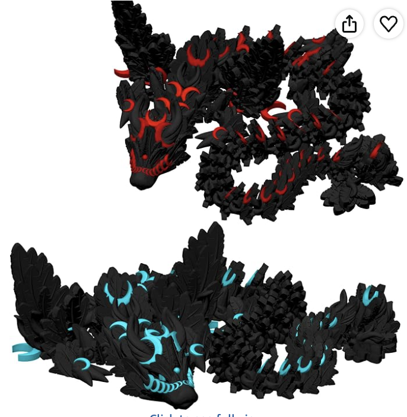

# Godzilla / kaiju references for claude-boss

**Direction:** start with [boss-4](boss-4.png)'s readable Godzilla body, borrow [boss-1](boss-1.png)'s charged dorsal silhouette, and use [boss-2](boss-2.png), [boss-3](boss-3.png), and [boss-5](boss-5.png) as distinct anatomy/material variants. A heavy torso, small forearms, planted feet, a long counterbalancing tail, and a deliberately shaped dorsal ridge should remain recognizable before adding repository limbs, source glyphs or effects.

These are **five unchanged image attachments** from 林海阔 to the **codex Feishu bot**. I viewed all seven user image messages from today's complete chat listing: five kaiju references and the two hero sheets already saved in [README.md](README.md). This is a visual brief; it does not modify product code or generated sprites. Descriptive creature names below identify visible shapes, not an asserted canonical game/film version.

## Complete image-message inventory and provenance

Queried chat `oc_e0decba894219dffa8d4868c05aad646` as **bot**, filtering the returned image messages to sender open_id `ou_3db23cf05c03b4942c355797cc88e8f9`. The day window is **2026-10-24 00:00:00−04:00 to 2026-10-25 00:00:00−04:00** (America/New_York). CLI pagination reported **complete: true, pages: 1, items: 15**; there were **seven user image messages**. No thread expansions/image replies were present. Times below are the CLI's rendered creation times. Ordering is the API's ascending message order; the five boss images share the same displayed minute.

| Saved file | CLI time, Oct 24 | Message / source | Classification | Original dimensions; bytes |
| --- | --- | --- | --- | --- |
| [boss-1.png](boss-1.png) | 16:17 | [`om_x100b62e569c0d0a0b01189ea397ce25`, position 362](https://applink.feishu.cn/client/chat/open?openChatId=oc_e0decba894219dffa8d4868c05aad646&position=362) | Cyan Godzilla-like pixel kaiju | 854 × 850; 469,649 |
| [boss-2.png](boss-2.png) | 16:17 | [`om_x100b62e569db30a4cf47052c5fb196a`, position 363](https://applink.feishu.cn/client/chat/open?openChatId=oc_e0decba894219dffa8d4868c05aad646&position=363) | Gold three-headed winged dragon / kaiju | 900 × 854; 595,911 |
| [boss-3.png](boss-3.png) | 16:17 | [`om_x100b62e569ede0a0cee678896b7bed6`, position 364](https://applink.feishu.cn/client/chat/open?openChatId=oc_e0decba894219dffa8d4868c05aad646&position=364) | Silver mechanical Godzilla-like pixel kaiju | 730 × 882; 190,622 |
| [boss-4.png](boss-4.png) | 16:17 | [`om_x100b62e569e6e8a0cfdcc40e42375b9`, position 365](https://applink.feishu.cn/client/chat/open?openChatId=oc_e0decba894219dffa8d4868c05aad646&position=365) | Simplified dark-green Godzilla sprite | 936 × 902; 36,170 |
| [boss-5.png](boss-5.png) | 16:17 | [`om_x100b62e569f8aca0b4ae0c3d367a25c`, position 366](https://applink.feishu.cn/client/chat/open?openChatId=oc_e0decba894219dffa8d4868c05aad646&position=366) | Two black segmented dragons, red/cyan accents | 686 × 702; 493,179 |
| [hero-2.png](hero-2.png), preserved | 16:27 | [`om_x100b62e504446ca0ce429232c8d7f5b`, position 372](https://applink.feishu.cn/client/chat/open?openChatId=oc_e0decba894219dffa8d4868c05aad646&position=372) | Six Duelyst hero poses; not a boss reference | 1100 × 700; 723,585 |
| [hero-1.png](hero-1.png), preserved | 16:27 | [`om_x100b62e5045ed0a0b07dc523cfcb3cf`, position 373](https://applink.feishu.cn/client/chat/open?openChatId=oc_e0decba894219dffa8d4868c05aad646&position=373) | Nine Duelyst hero silhouettes; not a boss reference | 600 × 667; 353,970 |

Reproduction route (read/download only; run in a scratch directory so raw chat output and extra downloaded resources do not enter the repository):

```sh
export LARKSUITE_CLI_NO_UPDATE_NOTIFIER=1 LARKSUITE_CLI_NO_SKILLS_NOTIFIER=1
lark-cli im +chat-messages-list --as bot \
  --chat-id oc_e0decba894219dffa8d4868c05aad646 \
  --start '2026-10-24T00:00:00-04:00' \
  --end '2026-10-25T00:00:00-04:00' \
  --order asc --page-size 50 --page-all --page-limit 100 \
  --no-reactions --download-resources --format json
```

Check `ok`, `identity`, `meta.pagination.complete` and per-resource download results before claiming completeness. Only image attachments from the specified user were promoted into this reference set. No messages, reactions, bot replies or other external writes were sent.

## Boss 1 — electric cyan dorsal ridge



- **Silhouette:** Right-facing, upright reptile with a projecting snout, open jaw, small reaching forearms, rounded belly and a broad tail sweeping left. The sawtooth ridge runs from the upper back down toward the tail; irregular forked plate tips are its strongest identifier.
- **Proportions:** Tall, heavy torso; head appreciably smaller than the trunk; short arms; a thick thigh and planted foot. The tail is thick at the hip and tapers into a lifted left tip, counterbalancing the forward head/arms. Read the whole head–back–tail curve rather than assembling disconnected circles.
- **Dorsal plates:** Large branching, flame/crystal-shaped cyan clusters, with uneven spacing and height. The tallest plates sit around the shoulder/upper back; smaller accents continue along the descending back and tail. They visibly break the outer contour.
- **Pose:** Head raised and mouth open as if roaring or winding up; elbows bent and hands extended. The planted lower body and lifted upper body make a clear anticipation pose. Preserve the tail's broad sweep as part of the mass, not a thin decoration.
- **Palette:** Deep navy/slate body, blue-green midtones and bright cyan/turquoise accents against black. Dense alternating pixel clusters provide scale texture. Use a few deliberate shade families rather than copying the screenshot's many resampling colors.
- **Lighting:** Cyan catches the dorsal outline, face, forearms and some belly/leg texture. The bright spine and darker body give an emissive-charge impression without a large atmospheric bloom or realistic cast shadow.
- **Details worth copying:** Forked plates with distinctive negative spaces; a short, readable jaw opening; small claw tips; tapered tail; uneven scale clusters concentrated on body planes. For an attack wind-up, a head-to-tail or tail-to-head plate-light sequence is a proposed animation, not motion demonstrated by this still.
- **Gitzilla translation:** Make the spine an unmistakable kaiju landmark, then let repo identity select its silhouette/etching. Put code on stable body planes and light it selectively; keep a dark mass behind the glowing source/heart region so glyphs and warnings remain legible.

## Boss 2 — gold three-headed winged kaiju



- **Silhouette:** Three horned heads and long curving necks rise on the left; an enormous ribbed wing fans to the right; a narrow, extended tail bends upward at the far right. Parts of the leftmost heads are cropped by the supplied screenshot.
- **Proportions:** Small central trunk relative to the wings and necks; long S-shaped necks, thick upper thighs and small clawed feet. Wing span and tail length dominate width, while multiple necks provide height without making the body a simple rectangle.
- **Dorsal plates / equivalent landmarks:** The main landmarks are branching horns, small neck/back spines and the angular wing ribs, rather than a tall Godzilla-style dorsal sail. Don't add a continuous giant ridge just because the other references have one.
- **Pose:** Left-facing, alert heads at different heights, open mouths and an upright supported body. Wing extended in a large fan; tail sweeps behind. Staggered heads create an asymmetric threat silhouette even when the torso is still.
- **Palette:** Pale yellow-gold highlights, saturated gold midtones, ochre/brown recesses and black separation; tiny warm/red eye accents. Checker/dither patches describe rounded necks and thighs. The gray rounded controls at bottom right are screenshot UI, not creature parts or palette references.
- **Lighting:** Bright stepped highlights run along upper neck curves, horns and wing edges; darker horizontal wing ribs give the membranes depth. This is graphic pixel shading, not a large glow cloud.
- **Details worth copying:** Clear separation between the necks; short recurring neck spines; wing ribs with alternating bright membrane/dark support; horned head profiles; one sweeping tail line. Reduce dithering before reducing those large forms.
- **Gitzilla translation:** A multi-head/wing variant can map actual components to separately readable heads or wing lobes. Name each visible component; keep heads separated during casts so the source can be highlighted. Draw decorative wing extent separately from the sim's real hit regions; artwork does not authorize larger collision geometry or stronger attacks.

## Boss 3 — silver mechanical kaiju



- **Silhouette:** Tall left-facing machine reptile: narrow angular head above a long armored trunk, forward-bent blocky hands, huge cylindrical thigh/hip masses, a jagged rear-fin outline, and a thick segmented tail trailing right.
- **Proportions:** Head is small relative to the broad lower body; torso is column-like and the thighs are exceptionally chunky. Short arms and a long counterweight tail retain the Godzilla body plan despite the mechanical materials. Large feet make the heavy upright posture believable.
- **Dorsal plates:** Stacked gray triangular/trapezoidal fins protrude from the right-facing rear contour, separated by black seams. Smaller blocks/teeth continue along the tail. Treat them as rigid metal modules with alternating lengths.
- **Pose:** Upright, slightly forward-looking head, elbows bent and hands ahead of the chest. The low planted foot and horizontal tail suggest a braced firing stance, not a floating humanoid robot.
- **Palette:** Black gaps, charcoal/dark gray, medium silver and sharp white highlights; salmon-red/orange eyes are the main warm accent. Bitmap examples include mid-gray `#666666` and light metal `#adadad`; these are sampled source pixels, not a complete production palette.
- **Lighting:** Hard white ledges on the head, panel rims, thigh bands and tail joints imply polished metal. Broad flat faces and thick dark seams carry volume; there is no need to brighten every plate equally. The red eyes are a small focal point.
- **Details worth copying:** Banding around cylindrical hips, rectangular chest panels, small dark fastener/port dots, clear fin-to-body gaps, repeated articulated tail joints and square claw/foot shapes. Avoid turning panel seams into full-body visual noise.
- **Gitzilla translation:** Excellent for a machine/enterprise/kernel variant. Component panels can show a short symbol or a small health crack. A broken component should interrupt a contiguous panel/fin silhouette and extinguish that panel's local light. Keep the bright eye and heart distinguishable from a field of white metal highlights.

## Boss 4 — readable minimal Godzilla base



- **Silhouette:** A clean right-facing Godzilla shape with a blunt snout, compact upper body, small front arms, very heavy legs/feet and a long diagonal tail curling upward on the left. Thick black stepped outlines make the shape work at small size.
- **Proportions:** Chunkier and more compact than boss-1: large head/snout, short neck, deep belly and broad haunches. Tail and back form one continuous rising diagonal into the neck. Feet are broad rectangles that anchor the mass.
- **Dorsal plates:** A handful of large rectangular/stepped mint fins, varied in height, follow that diagonal from tail to upper back. They are readable geometric clusters with clean gaps; no scale texture is needed to communicate the ridge.
- **Pose:** Stable right-facing idle/ready stance, short forearms extended, head level and the tail tip hooked up behind. Clear eye–snout direction gives the creature personality without an elaborate facial animation.
- **Palette:** Near-black outline; very dark green body; muted gray-green underside; bright mint/teal spine, eye and small facial accent. Sampled pixels include `#183532`, `#4d6f6c`, `#6a8a87` and `#63d3c4`. Treat these as examples from this bitmap, not mandatory final kit colors.
- **Lighting:** Flat, selective shade blocks: lighter underside and spine, dark back/body mass. No soft glow, continuous gradient or detailed ambient shading. White surrounding margin is part of the source image, not an intended arena background.
- **Details worth copying:** The tail hook, staggered spine heights, single bright rectangular eye, small arm versus giant thigh contrast, and black gaps that keep arms, belly and feet separate. This is the strongest reference for a native-resolution silhouette pass.
- **Gitzilla translation:** Use this body plan as the first blockout. Maintain coherent head/trunk/hips/tail while fitting repo-derived component lobes into visible locations. At smaller scales, spend pixels on spine, snout, forearms and feet before displaying source text or particles. Boss-1's charged plate treatment can add life after this reads clearly.

## Boss 5 — segmented black dragons with red/cyan inlays



- **Silhouette:** Two long low/coiled dragons, rather than upright bipeds. Large horned heads lead chains of chunky, jagged body segments and tapering tails; swept-back head fins and side projections make the outlines thorny. The upper design is red-accented and the lower is cyan-accented.
- **Proportions:** Large armored head compared with each individual body segment, repeated articulated sections, low profile and a long serpentine body. The coils expose gaps between sections and make the large creature feel assembled from linked pieces. Unlike boss-1/4, a pair of giant planted thighs is not the main structural feature.
- **Dorsal plates:** Overlapping black leaf/flame-shaped scales, spikes and swept fins occur on head, back and body sections. Many plates carry crescent-shaped red/cyan inlays. Vary leading/trailing plate size while keeping a consistent direction of overlap.
- **Pose:** Coiled/resting S- and loop-like bodies, broad faces turned toward the viewer at a three-quarter angle, horns and cheek fins spread. These are still images of sculpted/rendered-looking designs, not a pixel animation sheet; the exact construction/medium is not established by the image alone.
- **Palette:** Near-black/charcoal plates with restrained gray highlights, punctuated by bright red above and turquoise/cyan below. The eye/mouth details and curved inlays are sparse color anchors. White background and top-right share/heart UI are outside the creature design.
- **Lighting:** Soft neutral highlights reveal the thickness and bevels of dark overlapping plates. Accent strips look luminous/high contrast, but the still does not establish physically emitted light. Translating them to pixel art should use a small dark/light ramp with a few bright inlays.
- **Details worth copying:** Repeated body joints, armor plates pointing consistently backward, crescent/rune-like accent cuts, a broad fanged face, and distinct head/neck/body/tail rhythms. Do not copy interface icons or the clipped lower-page text.
- **Gitzilla translation:** Strong inspiration for a repo-graph serpent: actual components become chunky body segments and verified import links become articulated connectors. Leave gaps so components can be highlighted/broken individually. Use repo tokens as sparse inlays in place of ornamental marks; preserve a clear head and a single dominant flow through the body. Red/cyan accent variants can communicate phase or kit identity without repainting every surface.

## Brief for the existing boss renderer

These are proposed applications of the observed shapes; no renderer changes are part of this task.

1. **Silhouette first.** Block out the torso, projected snout, dorsal outline, small arms, heavy feet and long counterbalancing tail using boss-4. At the current boss display scale, verify those landmarks with interior text and particles hidden. Preserve their connection as one creature through breathing, turning and attacks.
2. **Add repo anatomy with a visual hierarchy.** A stable central body and clear head/tail establish the kaiju. Fit the existing real components into distinguishable lobes/panels/heads; their labels, cracks and glows carry the code identity. Use boss-2 for multi-head variants and boss-5 for a segmented-body variant, rather than stacking all five references into every boss.
3. **Make dorsal plates part of the contour.** Use uneven sizes, actual gaps, tapering toward the tail, and a coherent attachment direction. Borrow boss-1's cyan edge energy or boss-3's rigid gray metal fins according to the kit palette/theme. Light plates progressively for a cast or phase change; animation timing must follow the authoritative warning.
4. **Keep material palettes disciplined.** Organic: dark body + restrained midtone + pale underside + one energy hue. Metal: dark seams + flat gray faces + white edge clusters + tiny warm eye. Segmented dragon: charcoal plates + sparse colored inlays. Preserve kit identity while giving the heart, eye and active attack source separate readable roles.
5. **Use large pixel clusters.** The supplied images include enlarged/filtered pixel art and a sculpted/rendered-looking reference. Reconstruct their shapes at the renderer's native resolution with nearest-neighbor scaling; don't reproduce screenshot blur, repeated resampling colors or UI overlays. Dense scales/dithering are portrait detail, not a prerequisite for the arena silhouette.
6. **Respect current simulation geometry.** `BossState.regions` remains the source of hit-region placement; component names come from `BossKit.limbs[].component`, and attacks from `BossKit.attacks[].source`. Decorative tail/wings/plates don't create extra colliders, attacks or stat budget. Keep active source highlights visible above ornamental texture, and distinguish a heart from merely bright armor.
7. **Make state changes physical and localized.** A firing head leans/opens its jaw; a charged ridge brightens; a broken component loses a lobe/panel's integrity while the central creature survives. Small arms recoil, the torso breathes, the tail follows with a delay, and heavy feet remain anchored. Reduced motion retains silhouette/state changes without shake or rapid flashes.

Suggested priority within the hackathon: **boss-4 silhouette → boss-1 charged plates → one material/body variant**. A strong recognizable creature with readable component sources is more valuable than simultaneously rendering every scale, wing rib, code line and particle.

## Original-file integrity

All five boss files passed Pillow image verification and are byte-for-byte copies of downloaded PNG resources. No crop, resize, recolor, background removal or other edit was applied. The two hero files were hash-checked against their newly downloaded originals and left unchanged.

```text
boss-1.png  9cf7c0ec54f42e585788af9f199dc48e92958b3ca5dbfa54c94db4916ffc5bbc
boss-2.png  572fb8835067e1c71137d777ae805d856d74038fe641617790138b53ce59f5a6
boss-3.png  813105ff0fed3f83fe78169dc70efa08eedb31b52b5b8f223c84d701fdd689f3
boss-4.png  d46f019a8da493c3778e083f54aa54d9168bb0c7529009982349d90832c8f2c6
boss-5.png  df0dca289a54e362c0e963d7a20b615a6006985e39966d03412a0c32378a598d
```
