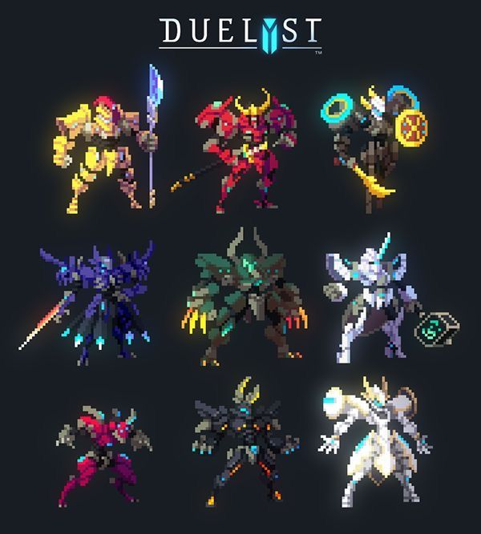
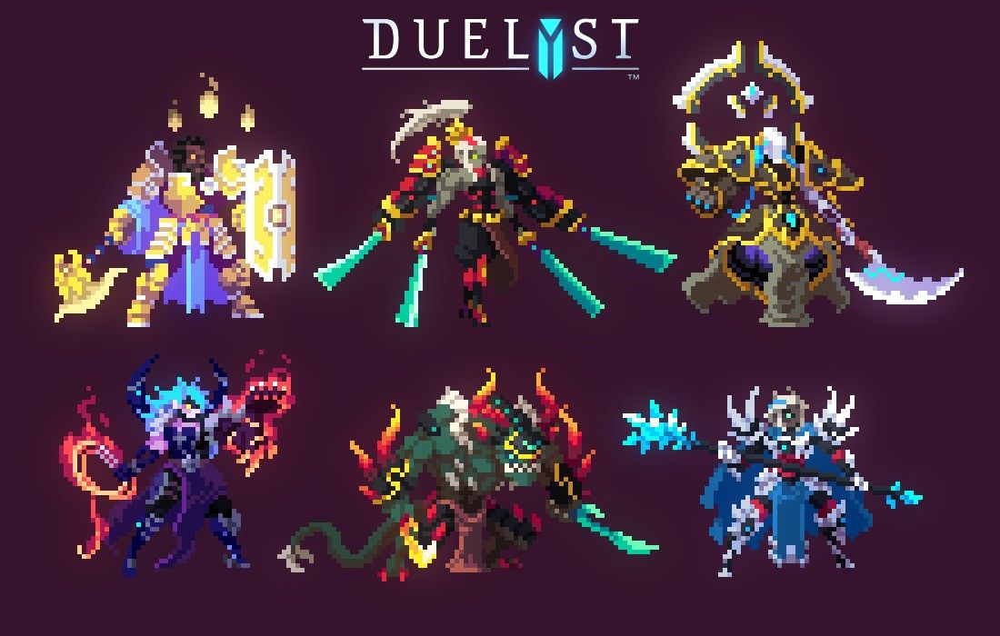

# Hero design references for claude-player

These are the two most recent image messages from **林海阔** to the **codex** Feishu bot, both displayed by the CLI as **2026-10-24 16:27**. Retrieved with bot identity; user login was unnecessary. Originals are preserved unchanged, newest first.

| File | Source | Original size |
| --- | --- | --- |
| [hero-1.png](hero-1.png) | [Newer image, message position 373](https://applink.feishu.cn/client/chat/open?openChatId=oc_e0decba894219dffa8d4868c05aad646&position=373), message `om_x100b62e5045ed0a0b07dc523cfcb3cf` | 600 × 667; 353,970 bytes |
| [hero-2.png](hero-2.png) | [Previous image, message position 372](https://applink.feishu.cn/client/chat/open?openChatId=oc_e0decba894219dffa8d4868c05aad646&position=372), message `om_x100b62e504446ca0ce429232c8d7f5b` | 1100 × 700; 723,585 bytes |

The message sender is confirmed as 林海阔, open_id `ou_3db23cf05c03b4942c355797cc88e8f9`. The initially suggested `ou_f68a9a034189cc1eac9c48e1bd41c8c6` resolves to a different bot p2p chat with no messages in the inspected hour. Selection uses the actual sender name/ID and descending message order, not that initial ID assumption. No Feishu messages were sent.

## Reference 1 — nine distinct armored silhouettes



**What it shows:** A 3 × 3 grid of nine Duelyst-branded pixel characters on a near-black background: gold/purple lance fighter, crimson horned warrior, ring-bearing robed fighter, dark violet swordsman, green clawed beast, pale cyan/lilac armored fighter, magenta rogue, dark long-eared/beastlike fighter, and white/gold orb caster. These are visual descriptions, not canonical class names.

- **Style:** Readable pixel clusters, stepped armor highlights, angular overlapping plates, glowing eyes/weapon edges. Most characters combine dark cloth or under-armor with one strong faction hue and a small brilliant energy accent.
- **Proportions:** Compact heads inside pronounced helmets; broad shoulders, a distinct waist, separated thighs/shins/boots. Long limbs and long weapons give a poised fantasy-fighter silhouette. This reference has more body articulation than an oversized-head chibi.
- **Palette:** Gold/yellow with plum shadows; crimson with near-black; forest green with amber claws; pale silver/lilac with electric cyan. Sampled bitmap colors include lavender `#b5aee1`, bright yellow `#fff959`, and cyan `#41f6ff`; these are examples, not a complete palette.
- **Details worth adopting:** Horns/crests that identify the head at a glance; shoulder/cape asymmetry; a clearly separated weapon hand; bright blade tips or an orb; negative space between arms and body; two readable feet. Give each repo a recognizable outline before adding interior decoration.

## Reference 2 — larger poses, weapons and material contrast



**What it shows:** A 3 × 2 grid of six larger characters on a dark burgundy background. The upper row has a blue/gold shield guardian, a black/red/gold fighter with several turquoise blades, and an ornate black/gold/cyan armored figure with a crescent weapon. The lower row has a violet/cyan caster with red-orange fire, a green horned reptilian warrior with a sweeping tail and cyan blade, and a blue/white armored caster with an icy staff.

- **Style:** Strong three-quarter poses and readable weight shifts; large armor panels and equipment form the silhouette. Flat pixel clusters build the materials, with intense local light on magic, blades and gems. Some energy effects have a softer halo around the crisp character shapes.
- **Proportions:** Small visible face/visor relative to the shoulder and equipment mass; torso and hips remain distinct; bent knees and uneven arm positions make the characters feel ready to act. Oversized shields, crescents, staffs and tails provide personality without enlarging the head.
- **Palette:** Deep blue/near-black foundations, ivory armor highlights, gold trim and saturated turquoise energy; red-orange magic deliberately contrasts with cool cyan faces. Sampled bitmap colors include deep blue `#114c84` and gold `#fcef62`.
- **Details worth adopting:** Shield as a large uninterrupted readable shape; gold edging on dark armor; a bright visor/face focal point; cloth panels hanging between the legs; an off-axis weapon; short parallel glow strokes on a blade; a few large flame/crystal shapes instead of many tiny particles.

## Gitzilla implementation brief

1. **Start with a posed hero silhouette:** helmet/crest, shoulders/cape, torso/waist, two separated legs, and a distinctive held weapon. Use the references' three-quarter weight and asymmetry; keep the face readable against the armor.
2. **Make code the material:** brace-shaped shoulder armor, a cursor visor, syntax-colored plate edges, a source-text cape and the repo's token on a chest plate. Place those details on a coherent fighter body.
3. **Let the weapon carry identity:** choose a strong barrel/blade/staff outline and one luminous focal point. Preserve the complete case-sensitive `kit.code.weapon.name`; let its projectiles/muzzle/impact supply the matching code effects.
4. **Keep palette hierarchy:** dark outline/shadow, primary faction/language color, pale face/metal highlight, and one energy accent. Add controlled shade variants for armor volume; keep glow concentrated around energy sources.
5. **Scale detail by view:** portraits can show layered plates, cloth, gauntlets and a source-covered terminal base. At roughly 20 logical pixels in the arena, preserve the crest, shoulder/cape shape, weapon and feet; reduce the rest to a few deliberate clusters. Draw at native pixel resolution with nearest-neighbor scaling.
6. **Prioritize readable movement:** weapon follows the lead hand, feet alternate, cloth/cape lags the torso, and the visor/energy pulse provides idle life. Keep the repo-specific silhouette recognizable through firing, dash and hurt poses.

The observations above come from viewing both downloaded images. The six implementation points are a proposed translation into Gitzilla's existing procedural/code-art system; no renderer or generated sprite has been changed by this task.

## Integrity

Both PNGs opened successfully and passed Pillow image verification. SHA-256:

```text
hero-1.png  9f07bbfca7c5bdc7917d335fe4156310a5771eee845bca75ea1009856c35c2cb
hero-2.png  9a4cd2f7ce44e8236ae93a8f3e6d180251d42f40a793a42c47e842d8d0982c12
```
